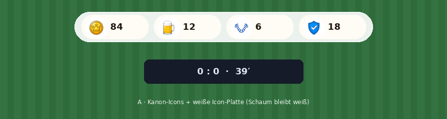

# Wallet-Bar — grafische Vorschläge

**Status:** Vorschlag A gewählt · Icons mit Agents abgeklärt  
**Stand:** 2026-10-08  
**Review-Seite:** [index.html](./index.html)

## Absprache: Welche Icons sind die aktuellsten?

| Satz | Branch | Rolle |
| --- | --- | --- |
| **Kanon / Deploy** | `cursor/currency-icons-clean-dba3` | HUD-Logos + FX — Quelle der Wahrheit |
| Älter (Bold-Outline) | `cursor/icon-ui-einzeln-3755` | Vorgänger; **nicht** Deploy-Default |
| Älter | `cursor/matchday-icons-a9b1` | noch älter |

Pfade (Kanon):

- `game/public/icons/ui/currency-gold.png` — Münze + Krone  
- `game/public/icons/ui/currency-bier.png` — Bierglas + Schaum  
- `game/public/icons/ui/currency-fanartikel.png` — blau-weißer Fan-Schal  
- `game/public/icons/ui/currency-sicherheit.png` — blaues Schild + Haken  

Bestätigt u. a. durch Icon-UI-Agent (`bc-01a11a72`) und `CURRENCY_FX_CANON.md` (HUD = Logo + Live-Zahl; FX getrennt).

### Warum wirkte der Schaum schwarz?

1. **AI-Renders** in der ersten PR-Version haben die Icons **verfälscht** (schwarzer Schaum, schwarze Schal-Streifen, schwarzer Haken). Diese Dateien sind entfernt.
2. Das echte Kanon-Bier hat weißen Schaum, aber der Schaum ist **teilweise transparent**. Auf **grünem Rasen** scheint die Fläche durch → Schaum wirkt schwarz. Auf weißer Chip-Platte bleibt er weiß (Beweis: `bier-fix-without-plate.png` vs `bier-fix-with-plate.png`).
3. Zusätzlich hat der Kanon-Satz deutlich weniger opake Schaum-Pixel als `icon-ui-einzeln` (~300 vs ~9000) — bei sehr kleinen Größen (≤28px) wirken Konturen stärker.
4. Schal/Schild im Kanon sind **dünner / helleres Blau** als der Bold-Outline-Satz — laut Agents der freigegebene Deploy-Satz, nicht „falsch“.

Vergleich:

- [currency-icons-branch-compare.png](./currency-icons-branch-compare.png) — alle Branches groß  
- [currency-hud-scale-compare.png](./currency-hud-scale-compare.png) — 28 / 40 / 64 / 128px  
- [vorschlag-a-real-icons-compare.png](./vorschlag-a-real-icons-compare.png) — A1 Kanon vs A2 icon-ui @36px + Bier-Zoom  

**Empfehlung für Runtime A:** Kanon-PNGs (`currency-icons-clean-dba3`), Icon **≥ 36–40px**, **weiße runde Icon-Platte** unter jedem freigestellten Logo.

## Vorschlag A — Frosted Chips (gewählt → Runtime)

**Runtime:** `.wallet-bar` in `game/src/style.css` / `main.ts`  
- schmal (dünner Ring, wenig Padding)  
- Soft-Bind `data-wallet-cur` → `UI_ICONS.currency*`  
- ein `--wb-scale` von `#game-wrap` (100cqw/900px), Icons `aspect-ratio: 1`  
- weiße Icon-Platten gegen transparenten Schaum  

Glas-Ring + einzelne helle Pills + weiße Icon-Platten, Reihenfolge Gold → Bier → Fanartikel → Sicherheit.

## Vorschläge B / C

Unverändert als Alternative dokumentiert (`vorschlag-b-stage.png`, `vorschlag-c-stage.png`).
